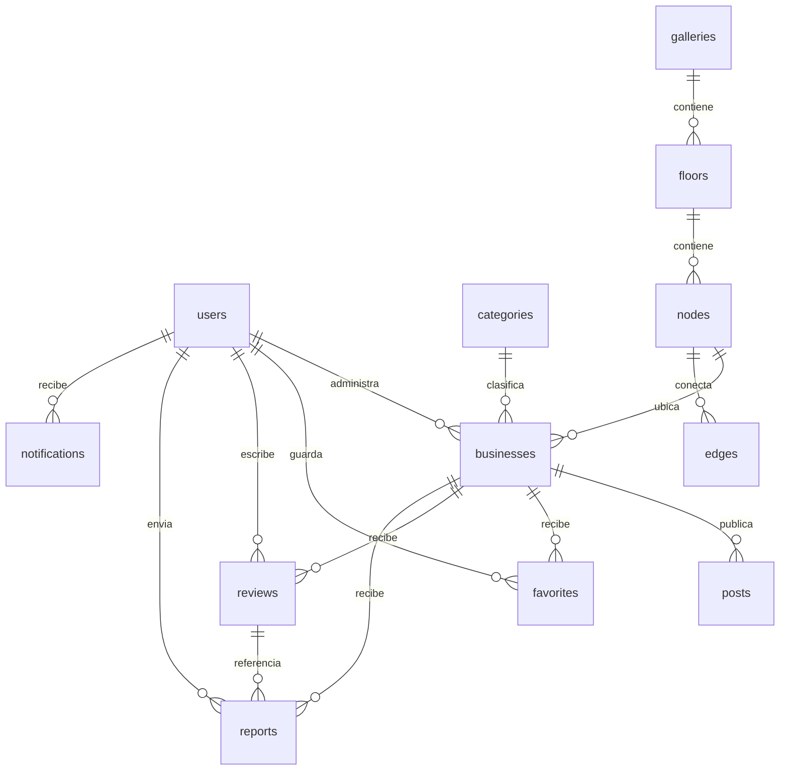

# Guion de presentación académica

Duración sugerida: 7–10 minutos. Usar la base local demo o cuentas propias de producción.

1. **Problema (30 s).** Encontrar el edificio no siempre significa encontrar el negocio. LocalConnect combina un directorio comercial con orientación dentro de galerías.
2. **Descubrimiento (1 min).** Buscar “Café”, filtrar Moda y abrir una ficha. Mostrar horarios, categoría y favoritos persistentes con una cuenta visitante.
3. **Valor diferencial (2 min).** Abrir el plano, elegir Acceso lateral como origen y Librería Norte como destino. Calcular la ruta común (74 metros en el escenario demo). Activar accesibilidad y recalcular (172 metros): pasa por el ascensor. Mostrar ambos pisos y la lista ordenada de puntos.
4. **Orientación QR (1 min).** Generar el QR de un punto. En el sitio publicado, escanearlo con la cámara del celular. El enlace establece el origen; no es GPS en tiempo real.
5. **Participación (1 min).** Escribir una reseña y enviar un reporte. Aclarar que hay una reseña editable por usuario y comercio.
6. **Gestión (2 min).** Ingresar como comercio, registrar uno y publicar una promoción. Ingresar como administrador y aprobar el comercio. Mostrar que los totales del dashboard cambian con datos reales de la BD.
7. **Modelo técnico (1 min).** React consume una API PHP; PDO usa consultas parametrizadas hacia MySQL. Sesiones y roles protegen las modificaciones. Las tablas `nodes` y `edges` representan un grafo; Dijkstra minimiza la distancia y descarta conexiones no accesibles según la opción elegida.

## Modelo relacional principal

## Preguntas previsibles

- **¿Por qué PHP?** Compatibilidad con el hosting Premium disponible; React + TypeScript se conserva en la interfaz.
- **¿Cómo sabe dónde estoy?** Selección manual de origen o QR de referencia, sin infraestructura de rastreo.
- **¿Qué pasa si se cierra un pasillo?** El administrador deshabilita la conexión; Dijkstra la excluye. Si no queda ruta, se informa explícitamente.
- **¿La ruta accesible está garantizada físicamente?** Solo según los datos del grafo. El piloto es simulado; un despliegue real requiere verificar planos y condiciones del edificio.
- **¿Cómo se evita que un comercio edite a otro?** El servidor compara la propiedad y el rol en cada operación; ocultar botones no es la medida de seguridad.
- **¿Se puede usar para todos los comercios de Tucumán?** El modelo admite más galerías y comercios; esta entrega es un piloto con datos limitados.

No presentar el escenario simulado como relevamiento real ni afirmar GPS interior, pagos, chat o notificaciones push, que no forman parte del prototipo.
